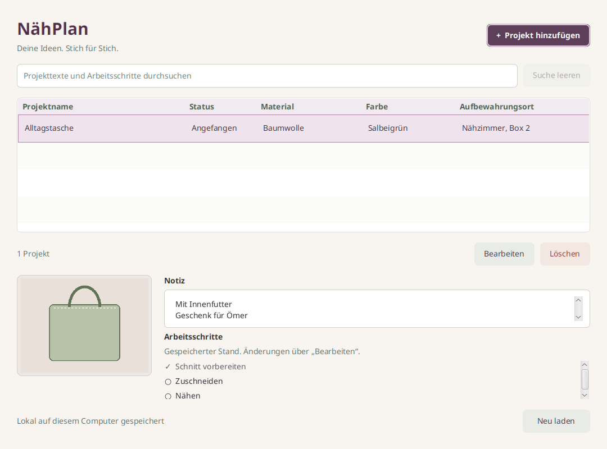

# Sewing Planner

Die [deutschen Mac-Store-Inhalte](docs/mac-app-store-fields.md) enthalten vier
Bildentwürfe und kopierbare Texte. Die Aufnahme verwendet vorhandene App-JARs
ohne App-Build. Native Mac-Aufnahmen und technische Veröffentlichung folgen separat.

Deine Ideen. Stich für Stich. Verwalte kleine Nähprojekte mit Projektname,
Stoff oder Material, Farbe, Aufbewahrungsort, mehrzeiliger Notiz, einem
optionalen Foto und dem Status **Geplant**, **Angefangen** oder **Fertig**.
Die Checkliste hält deine Arbeitsschritte fest. Alles bleibt lokal.



Stufe 4 der Java-Reihe BücherRegal → GarnBox → StrickProjekt → Sewing Planner.
KostümPlan bleibt die fünfte Reservestufe. Gegenüber StrickProjekt kommt
genau eine Hauptfunktion hinzu: die Checkliste pro Projekt.
Material ist Freitext ohne Verbindung zu anderen Apps.

## Mac-Korrekturen vom 1. November 2026

Cmd+Q fragt bei offenen Änderungen einmal nach. „Weiterbearbeiten“ behält den
Entwurf, „Verwerfen“ schließt die Anwendung. Laufendes Speichern bleibt geschützt.
Beim JSON-Export auf dem Mac zuerst den Zielordner wählen und danach den
Dateinamen eingeben. Diese Ordnerfreigabe ermöglicht den Export auch innerhalb
der Mac-App-Store-Sandbox. Abbruch erstellt keine Datei. Die bestehenden Regeln
zum Überschreiben bleiben erhalten. [Prüfung und Mac-Abnahme](docs/verification.md).

## Verbesserungen vom 31. Oktober 2026

Öffentlicher Name in allen Sprachen: **Sewing Planner**. Paketkennung und Datenpfade
bleiben unverändert. Neue Installationen starten auf Englisch, unabhängig von
der Systemsprache. Eine vorhandene Sprachwahl einschließlich „Automatisch“
bleibt erhalten. Die erste Store-Veröffentlichung wird auf Deutsch vorbereitet.

Hinzufügen und Bearbeiten öffnen sich zentriert über dem Hauptfenster.
Beim Laden des Editors blinkt die Tabelle nicht mehr. „Neu laden“ entfällt.
Speichern, Löschen und Import aktualisieren die Liste automatisch.

Die optionale Farbe wird über einen Farbwähler gewählt. Die Liste zeigt ein
Farbfeld und einen auch bei Auswahl lesbaren Hexwert. Bestehende Farbtexte
bleiben erhalten, bis bewusst eine Farbe gewählt oder entfernt wird.

Neu gewählte oder ersetzte Fotos werden proportional auf höchstens 1600 Pixel
an der längsten Seite verkleinert. Kleine Bilder werden nicht vergrößert.
Bilder ohne Transparenz werden JPEG mit Qualität 85 %, transparente Bilder PNG.
EXIF-Ausrichtung wird auf die Pixel angewendet, Quellmetadaten werden nicht
übernommen. Die Eingabegrenzen bleiben 10 MiB, 6000 Pixel je Seite und
16 Millionen Pixel. Originaldateien, bestehende Fotos und aus JSON
wiederhergestellte Fotobytes bleiben unverändert.
Die Fotoauswahl merkt sich den letzten bestätigten Ordner appweit und über
Neustarts hinweg in `photo-directory.txt`. Bei nicht erreichbarem Ordner wird
der Bilder- oder Benutzerordner verwendet. Abbrechen ändert die Einstellung
nicht. Die Ordnereinstellung gehört nicht zur Sammlungssicherung.

„Exportieren“ und „Importieren“ in der Fußleiste übertragen die gesamte
Sammlung als JSON, unabhängig von Suchfilter oder Auswahl. Enthalten sind
Texte, Hexfarben oder alte Farbtexte, Fotos als Base64 und der Projektstatus.
Auch Checklisten mit Text, Erledigt-Zustand, Reihenfolge und Schrittkennungen
sind enthalten. Wenn eine Schrittkennung bereits verwendet wird, bekommt nur
die neu ergänzte Kopie eine neue Kennung. Bestehende Projekte bleiben erhalten.

Das app-eigene Format heißt `sewing-planner.collection`, Version 1.
Import ergänzt atomar. Identische Kopien werden einschließlich ihrer Anzahl
berücksichtigt, sodass wiederholter Import keine weiteren Duplikate erzeugt.
Ungültige Dateien oder Fotos führen zum vollständigen Abbruch. Andere
App-Formate werden nicht als eigene Sicherung eingelesen. Vorhandene
Exportdateien werden nicht überschrieben.

Es gelten höchstens 10.000 Projekte, 1.048.576 Zeichen je Textfeld und 256 MiB
je JSON-Datei. Pro Projekt sind höchstens 10.000 Schritte zulässig.
Auch der Export prüft diese Grenzen vor Übernahme der Zieldatei.
Bereits vorhandene größere Sammlungen werden nicht gekürzt. Ihre Einträge
bleiben lesbar, bearbeitbar und löschbar. Für eine vollständige Dateisicherung
außerhalb dieser Exportgrenzen die App schließen und die Datenbank kopieren.

## Checklisten-Korrekturen vom 31. Oktober 2026

Die Checkliste hält rechts 16 Pixel Abstand zum Scrollbalken. Im Editor und
im Hauptfenster steht die Zahl der erledigten Schritte. Im Editor zählt sie
den aktuellen Entwurf, im Hauptfenster den gespeicherten Stand.

Enter im ausgefüllten Schritttext wechselt zum nächsten Schritt. Am Ende
entsteht eine neue leere Zeile. Enter in einer leeren Zeile fügt nichts hinzu.
Speichern erfolgt über die Schaltfläche oder Strg+S beziehungsweise Cmd+S.
Nach dem Entfernen bleibt der Tastaturfokus bei einem benachbarten Schritt
oder bei „Arbeitsschritt hinzufügen“. Fokussierte Eingaben werden bei Bedarf
in den sichtbaren Bereich gescrollt.

Bei 10.000 Schritten oder einer ausgeschöpften gespeicherten Schrittposition
bleibt das Hinzufügen deaktiviert und zeigt eine Erklärung. Vorhandene
Schrittkennungen und Positionen werden nicht umgeschrieben. Bearbeiten,
Abhaken, Entfernen und gemeinsames Speichern bleiben verfügbar.
Die Foto-Beschriftung für Screenreader bezeichnet in allen sechs Sprachen
das Projektfoto passend zur App.

## Starten

Build und CI verwenden Eclipse Temurin 21.0.13+9. Maven prüft Hersteller,
Version und Buildnummer. Für direkte Maven-Aufrufe auf diesem Rechner:

```bash
export JAVA_HOME="$HOME/.local/share/naehplan/jdk-21.0.13+9"
export PATH="$JAVA_HOME/bin:$PATH"
```

Ein vollständiges JDK 21 in `JAVA_HOME` und dessen `bin` im `PATH` verwenden.
Der Maven Wrapper lädt Maven und Abhängigkeiten beim ersten Start.
Die fertige App benötigt weder Konto noch Netzwerkzugriff.

Linux und macOS, aus diesem Verzeichnis:

```bash
./mvnw javafx:run
```

Windows PowerShell:

```powershell
.\mvnw.cmd javafx:run
```

Im vorhandenen Linux-Workspace findet `./scripts/run.sh` auch das JDK unter
`$HOME/.local/share/naehplan/jdk-21.0.13+9`. Das lokale Paket mit eingebetteter Laufzeit startet so:

```bash
"./target/app-image/Sewing Planner/bin/Sewing Planner"
```

Der sichtbare Produktname lautet Sewing Planner. Paketdateien, Launcher und
Datenverzeichnisse verwenden die ASCII-Schreibweise `NaehPlan` beziehungsweise
`naehplan`. Die App-Kennung ist `de.appfabrik.naehplan`.

## Bedienung

Die fünf Spaltenüberschriften sortieren per Klick nach Projektname, Status,
Material, Farbe oder Aufbewahrungsort. Jede Überschrift zeigt dauerhaft ein
Pfeilpaar. Die aktive Richtung wird hervorgehoben. Wiederholte Klicks wechseln
zwischen A–Z und Z–A. Die Spalten bleiben in ihrer ursprünglichen Reihenfolge
und lassen sich nicht verschieben.

Standard ist Projektname aufsteigend. Der alphabetische Vergleich richtet sich
nach der App-Sprache und ignoriert Groß- und Kleinschreibung. Status verwendet
den angezeigten übersetzten Text, Farbe den Farbcode oder vorhandenen Farbtext.
Suche, Speichern, Löschen und Import behalten die gewählte Sortierung.
Eine weiterhin sichtbare Auswahl bleibt dem gleichen Projekt zugeordnet.

„Projekt hinzufügen“ und „Bearbeiten“ öffnen denselben Dialog. Nur der
Projektname ist erforderlich. Gleichnamige Projekte sind unabhängig.
Neue Projekte beginnen mit „Geplant“ und einer leeren Checkliste.
Alle drei Statuswerte lassen sich jederzeit ineinander ändern.
Löschen verlangt eine Bestätigung und entfernt nur das ausgewählte Projekt
einschließlich seines Fotos und seiner Schritte.

„Arbeitsschritt hinzufügen“ ergänzt eine neue, noch offene Zeile am Ende.
Den Text direkt in der Zeile bearbeiten, das Kästchen abhaken oder wieder
öffnen und einzelne Zeilen mit „Entfernen“ entfernen. Gleichlautende Schritte
bleiben unabhängig. Leere Schritttexte werden mit einem verständlichen Hinweis
abgelehnt. Eingaben bleiben dabei erhalten. Eine vollständig leere Checkliste
ist gültig. Die Reihenfolge bleibt nach Speichern und Neustart erhalten.

**Erst „Speichern“ übernimmt Texte, Foto, Status und Checkliste gemeinsam.**
Abbrechen, Escape und Fensterschließen schützen auch ausschließliches Abhaken,
Wiederöffnen, Umbenennen, Hinzufügen oder Entfernen eines Schritts.
„Weiterbearbeiten“ ist die sichere Vorauswahl. „Verwerfen“ erhält den gespeicherten
Stand. Ein Speicherfehler lässt den Dialog mit dem gesamten Entwurf offen.
Die Checkliste im Hauptfenster zeigt ausschließlich den gespeicherten Stand.

Status und Checkliste bleiben unabhängig. Eine vollständig abgehakte Liste
setzt den Status nicht auf Fertig. Ein fertiges Projekt darf offene Schritte
haben. Statusänderungen beeinflussen keine Häkchen.

Die Suche durchsucht Projektname, Material, Farbe, Aufbewahrungsort, Notiz und
alle Schritttexte. Sie ignoriert Groß- und Kleinschreibung einschließlich Umlauten
und Unicode-Schreibvarianten. Mehrere passende Schritte erzeugen keine doppelten
Projekttreffer. Eine leere Suche zeigt alle Projekte.

## Foto

Genau ein JPEG oder PNG auswählen, ansehen, ersetzen oder entfernen.
Sewing Planner prüft den tatsächlichen Bildinhalt und speichert eine eigene Kopie
in SQLite. Die Quelldatei wird niemals verändert oder gelöscht. Das Foto bleibt
nach Verschieben oder Löschen der Quelle erhalten.

Grenzen: 10 MiB (10.485.760 Bytes), 6000 Pixel je Seite und 16 Millionen Pixel
insgesamt. Abgebrochene Dateiauswahl oder fehlgeschlagener Import erhalten das
bisherige Entwurfsfoto. Verspätete Vorschauen werden nach Auswahlwechseln
verworfen. Während Import und Speichern wartet der Dialog auf den Abschluss.

## Tastatur

| Taste | Aktion |
| --- | --- |
| Strg+N / Cmd+N | Projekt hinzufügen |
| Strg+F / Cmd+F | Suche auswählen |
| Enter oder Doppelklick in der Projektliste | Projekt bearbeiten |
| Entf in der Projektliste | Nach Bestätigung löschen |
| Strg+S / Cmd+S | Gesamten Dialog speichern |
| Escape | Abbrechen mit Verwerfschutz |
| Leertaste auf einem Kästchen | Schritt abhaken oder wieder öffnen |
| Enter im Notizfeld | Neue Zeile |
| Enter im Schritttext | Zum nächsten Schritt wechseln oder am Ende einen Schritt ergänzen |
| Tab / Umschalt+Tab | Steuerelement wechseln |

## Lokale Daten

`naehplan.db` enthält Projekte, Fotobytes und Arbeitsschritte.
Die Standardpfade liegen außerhalb von Programm und Quellcode.

| System | Datenverzeichnis |
| --- | --- |
| Windows | `%LOCALAPPDATA%\NaehPlan`, sonst `~/AppData/Local/NaehPlan` |
| macOS | `~/Library/Application Support/NaehPlan` |
| Linux | `$XDG_DATA_HOME/naehplan`, sonst `~/.local/share/naehplan` |

Zum Sichern die App schließen und `naehplan.db` kopieren. SQLite kann nach dem
Entfernen von Fotos freien Platz intern behalten. Mehrere gleichzeitig
bearbeitende Instanzen werden nicht unterstützt.

Isolierter Teststart mit einem eigenen absoluten Pfad:

```bash
./scripts/run.sh '-Djavafx.args=--data-dir=/tmp/naehplan-test'
"./target/app-image/Sewing Planner/bin/Sewing Planner" --data-dir=/tmp/naehplan-test
```

## Prüfen und verstehen

```bash
./mvnw spotless:apply
./mvnw verify
```

`verify` umfasst JUnit, Compiler-Lint mit Warnungen als Fehlern, Enforcer,
Spotless und SpotBugs. Die zusätzlichen echten JavaFX-Dialogtests benötigen
einen grafischen Bildschirm und werden ausdrücklich aktiviert:

```bash
./mvnw verify -Dnaehplan.uiTests=true
```

Tests verwenden temporäre SQLite-Dateien und synthetische Bilder.
[Prüfbericht und manuelle Abnahme](docs/verification.md) dokumentieren Ergebnisse
und Grenzen. [Architektur und Bewerbungsgespräch](docs/architecture.md) erklären
insbesondere stabile Schritt-IDs, gemeinsame Entwürfe und Transaktionen.

Java 21, JavaFX 21.0.11, SQLite JDBC 3.53.4.0, Maven 3.9.16 über Wrapper.
Ein Maven-Modul und ein eigenes Git-Repository. Keine gemeinsame Runtime mit
anderen Apps. [Paketierung](docs/packaging.md) bereitet Windows und macOS vor.
Native Zielplattformtests, Signierung und Store-Einreichungen stehen noch aus.
[Hinweise zu Fremdkomponenten](THIRD_PARTY_NOTICES.md).

Keine Unteraufgaben, Vorlagen, Abhängigkeiten, Termine, Verantwortlichen,
manuelle Umsortierung, automatischen Übergänge, PDFs, Cloud oder weitere
Hauptfunktionen. Es wurde nichts gepusht oder veröffentlicht.

## Sprachen und Store-Vorschau

Die Oberfläche unterstützt Deutsch, Englisch, Spanisch, Französisch, Italienisch
und brasilianisches Portugiesisch. Unter „Sprache“ wählbar, wirksam ab Neustart.
Bestehende Daten, Fotos, Status und Checklisten bleiben erhalten.
[Internationalisierung](docs/internationalization.md) beschreibt sechs Store-Textfassungen,
echte Bildschirmaufnahmen und geprüfte Vorschauordner ohne Lieferarchive.
Windows-Abnahme und Veröffentlichung bleiben separat.

## Datenschutz und Fokusrahmen

„Info“ → „Datenschutz“ öffnet die vollständige Datenschutzerklärung offline in der ausgewählten
App-Sprache. Der Dialog ist scrollbar, schreibgeschützt und kopierbar.
Escape oder „Schließen“ führen zurück. Er wird erst nach der Positionierung
sichtbar, damit die anfängliche Korrektur der Fensterposition verborgen bleibt.
Die Erklärung beschreibt die tatsächlich gespeicherten Texte, Fotos und die
jeweiligen Projektfunktionen. Originalfotos werden nicht verändert.

Löschschaltflächen erhalten einen roten Fokusrahmen. Die übrigen Schaltflächen
behalten die jeweilige App-Farbe. Die Auswahlfläche der Tabelle bleibt sichtbar,
der zusätzliche Rahmen der fokussierten Tabellenzeile ist transparent.

Die sechs identischen Texte für Partner Center lassen sich aus den Ressourcen
in einen neuen Ausgabeordner exportieren:

```bash
./scripts/export_privacy.sh target/privacy-texts
```

Ein vorhandener Ausgabeordner wird nicht überschrieben. Die vorhandenen
Prüfbedingungen für Vorschau-Lieferungen bleiben bestehen. Der neue Datenschutz-
ordner wird erst mit einer erneut geprüften Lieferung erzeugt.

## App-Icon und Ubuntu-Anwendungsmenü

Die App enthält ihr eigenes Icon für Fenster und Dialoge. Windows-Pakete verwenden
ICO, macOS-Pakete ICNS. Ubuntu ordnet das laufende Fenster über einen passenden
Anwendungseintrag demselben Icon zu.

Nach dem Linux-App-Image-Bau aus diesem App-Verzeichnis registrieren:

```bash
python3 "target/app-image/Sewing Planner/install_desktop.py"
```

Danach lässt sich die App über ihren Namen in der Ubuntu-Anwendungsübersicht
starten und bei Bedarf vom Nutzer im Dock anheften. Der Installer benötigt
Python 3, keine Administratorrechte und verändert keine Sammlung.
Mit `--data-dir=/absoluter/pfad` kann der Eintrag eine bereits verwendete eigene
Sammlung öffnen. Ohne diese Option gelten die normalen Datenpfade der App.
Beim Verschieben des App-Images den Installer vom neuen Speicherort erneut
aufrufen. Einen geöffneten Prozess anschließend regulär neu starten.

## Informationen zur App

Das Menü „Info“ bietet drei getrennte Fenster. „Über die App“ zeigt den
Produktnamen, die gebaute Version, eine kurze Beschreibung und den Supportkontakt.
„Datenschutz“ zeigt die vollständige Erklärung in der gewählten Sprache.
„Lizenzen“ enthält die Hinweise und Originaltexte zu den Fremdkomponenten.
Alle Inhalte sind offline verfügbar, kopierbar und schreibgeschützt.
Überschriften und Erläuterungen sind in allen sechs Sprachen vorhanden.
Rechtliche Originaltexte bleiben in ihrer Originalsprache. Weitere Hinweise
der eingebetteten Java-Laufzeit bleiben in deren Lizenzordnern erhalten.
