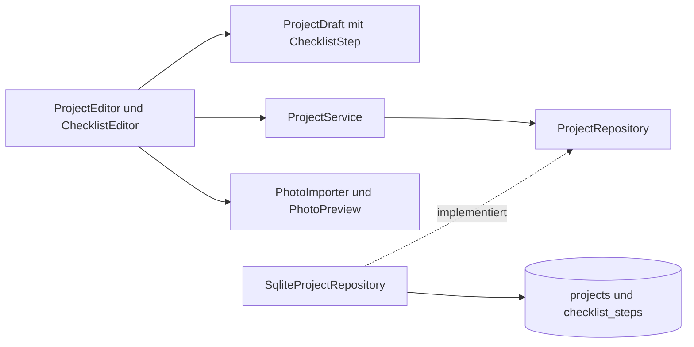

# Architektur und Bewerbungsgespräch

NähPlan besteht aus einem Maven-Modul mit vier Bereichen. Fotoimport,
Projektstatus, JavaFX-Grundgerüst und Paketierung wurden aus StrickProjekt
gezielt angepasst. Eigene Quellen, Kennungen, Datenpfade und Git-Historie
halten die App unabhängig. Die neue Hauptfunktion ist die Checkliste.

| Bereich | Aufgabe |
| --- | --- |
| `domain` | Unveränderliche Records für Projekte, Entwürfe und Schritte, Foto und Status-Enum |
| `application` | CRUD, Suche, Fotoimport, Speichervertrag ohne JavaFX oder JDBC |
| `persistence` | Datenpfad, Schema, JDBC und Transaktionen |
| `ui` | JavaFX-Fenster, gemeinsamer Entwurf, Checklistenfelder und Hintergrundarbeit |

Die Komponenten werden durch Konstruktoren verbunden. `ProjectsApplication`
ist der Einstieg für die Zusammensetzung. Ein Serial-Executor führt SQLite-
und Bildaufgaben aus. JavaFX-Task-Callbacks aktualisieren die Oberfläche auf
dem UI-Thread. Ressourcen werden mit `try-with-resources` geschlossen.

## Identität, Werte und Reihenfolge

`Project` trägt eine eigene SQLite-ID. Gleiche Namen sind erlaubt.
`ChecklistStep` ist ein Record mit `UUID id`, `String text`, `boolean completed`
und `int position`. Die UUID entsteht bereits beim Hinzufügen im Entwurf.
Umbenennen, Häkchen und Speichern ändern sie nicht. Text und Listenindex sind
keine Identität. Gleiche Schritttexte sind erlaubt.

Neue Schritte werden offen hinten angefügt. Positionen sind nicht negativ,
pro Projekt eindeutig und in aufsteigender Reihenfolge gespeichert. Beim
Entfernen dürfen Lücken bleiben. Die nächste Position liegt hinter der letzten
verbliebenen Zeile. Nach dem Öffnen wird ausdrücklich nach Position sortiert.
Es gibt keine Funktion zur manuellen Umsortierung.

`ChecklistStep` lehnt fehlenden Text und reinen Unicode-Leerraum ab.
`ProjectDraft` prüft den Namen sowie eindeutige Schritt-IDs und aufsteigende
Positionen. Defensive Listenkopien verhindern nachträgliche Veränderungen
an einem gespeicherten Stand. Notizformatierung bleibt erhalten.

| Status-Enum | Stabiler Speicherschlüssel | Anzeige |
| --- | --- | --- |
| `PLANNED` | `planned` | Geplant |
| `STARTED` | `started` | Angefangen |
| `FINISHED` | `finished` | Fertig |

Weder Ordinalzahlen noch übersetzte Anzeigen werden gespeichert. Neue Projekte
sind Geplant. Alle Wechsel sind erlaubt. Es gibt keine Abhängigkeit zwischen
Status und Häkchen. Auch Fertig mit offenen Schritten ist ein gültiger Zustand.

## Ein gemeinsamer Entwurf

`ProjectEditor.Input` hält die rohen Textwerte, das Foto, den Status und eine
unveränderliche Liste von `ChecklistEditor.StepInput`. Rohe Schritttexte dürfen
während der Eingabe leer sein. Erst Speichern erzeugt validierte Domain-Records.
Dadurch bleibt ein ungültiger Text im Dialog stehen und kann korrigiert werden.

Der ursprüngliche Input wird mit dem aktuellen Input verglichen. Record-
Gleichheit erfasst auch reine Häkchenänderungen, neue UUIDs, entfernte Zeilen
und umbenannte Texte. Abbrechen, Escape und Fensterschließen verwenden denselben
Verwerfschutz. „Weiterbearbeiten“ ist Standard, „Verwerfen“ schreibt nichts.

Die Hauptansicht verwendet für gespeicherte Schritte nur lesbare Labels.
Es gibt dort keine zweite Bearbeitungs- oder sofort speichernde Variante.
Während Import und Speichern sind konkurrierende Dialogaktionen gesperrt.
Bei Fehlern bleibt der gesamte Entwurf erhalten. Nur ein erfolgreicher
Speicher-Callback aktualisiert die Sammlung und schließt den Dialog.

## Gemeinsame SQLite-Transaktion

`projects` enthält Texte, Foto-BLOB und Status. `checklist_steps` enthält die
UUID, `project_id`, Text, Boolean als 0/1 und Position. Der Fremdschlüssel
verwendet `ON DELETE CASCADE`, jede Repository-Verbindung aktiviert ihn.
`UNIQUE(project_id, position)` verhindert doppelte Positionen. CHECK-Regeln
begrenzen Status, Schritttext, Boolean, Position und Fotogröße zusätzlich.

Ein vollständiges Speichern führt diese Schritte auf derselben Verbindung aus:

1. Auto-Commit deaktivieren und Projektzeile einfügen oder aktualisieren.
2. Bisherige Schritte dieses Projekts entfernen.
3. Den vollständigen Entwurfsstand mit denselben stabilen UUIDs einfügen.
4. Transaktion mit `commit()` abschließen und erst danach Erfolg zurückgeben.

Bei einem Fehler wird die gesamte Transaktion zurückgerollt. Ein erfolgreiches
Projekt-UPDATE genügt nicht, wenn später ein Schritt-INSERT scheitert. Tests
lösen genau diesen späten Fehler per SQLite-Trigger aus. Sie prüfen Texte,
Foto, Status, alte Schritte, neue Teilzeilen und erfolgreiches Wiederholen.
Auch ein fehlgeschlagenes Anlegen hinterlässt kein Teilprojekt.

Die vollständige Ersetzung der kleinen Liste hält den Code nachvollziehbar.
Die IDs bleiben dabei erhalten. Es gibt keine einzeln persistierenden
Schrittaktionen. Ein Löschvorgang entfernt die Projektzeile samt Foto und
zugehörigen Schritten. Andere gleichnamige Projekte bleiben erhalten.

Beim Laden werden beide Tabellen in einer Lesetransaktion gelesen. So gehören
Projekttexte und Schritte zum selben Datenbankstand. Fotos werden erst für das
ausgewählte Projekt geladen. Unbekannte neuere Schema-Versionen und ungültige
gespeicherte Werte führen zu einer Meldung statt stiller Reparatur.

## Suche und Fotos

Die Suche filtert die Projektliste einmal. Projekttexte oder mindestens ein
passender Schritt reichen als Treffer. `anyMatch` erzeugt auch bei mehreren
passenden Schritten nur einen Projekttreffer. NFC-Normalisierung und
`Locale.ROOT` behandeln Großschreibung und Umlaute. Ein deutscher `Collator`
sortiert nach Namen und danach nach Projekt-ID.

`PhotoImporter` prüft JPEG/PNG nach Inhalt, begrenzt Dateizugriff auf 10 MiB
plus ein Prüfbyte und prüft Dimensionen vor dem vollständigen Decodieren.
Maximal 6000 Pixel je Seite und 16 Millionen Pixel insgesamt. Decoderwarnungen
und Fehler werden abgelehnt. `Photo` kopiert Bytearrays defensiv und vergleicht
Inhalte. Originaldateien bleiben unverändert.

Erst erfolgreicher Import und erfolgreiche JavaFX-Decodierung ersetzen das
Entwurfsfoto. `PhotoPreview` verwirft verspätete Ergebnisse per Generationszähler.
Eine neue Auswahl kann dadurch kein Foto eines vorher ausgewählten Projekts
erhalten. EXIF-Rotation und besondere Farbprofile werden nicht aufbereitet.

## Im Bewerbungsgespräch erklären

„Die neue Funktion ist eine kleine Eins-zu-viele-Beziehung. Jeder Schritt hat
eine stabile UUID und eine explizite Position. Der Dialog hält alle Änderungen
zunächst lokal. Beim Speichern bilden Projekt und Schritte eine Transaktion.
Ein Test lässt das zweite Schritt-INSERT scheitern und weist nach, dass weder
Projektfelder noch Schritte teilweise geändert wurden. Status und Häkchen sind
bewusst unabhängig. Die Suche prüft Schritte mit anyMatch und liefert jedes
Projekt nur einmal.“

Zusätzlich zur vorherigen Stufe lassen sich damit Listenmodellierung,
Identität gegenüber Wertgleichheit, Fremdschlüssel, Transaktionsgrenzen,
Boolean-Eingaben und ein Entwurf über mehrere Tabellen nachvollziehbar zeigen.

Die Entscheidungen wurden mit der offiziellen Dokumentation zu
[SQLite-Transaktionen](https://www.sqlite.org/lang_transaction.html),
[Fremdschlüsseln](https://www.sqlite.org/foreignkeys.html) und
[JavaFX-Checkboxen](https://openjfx.io/javadoc/21/javafx.controls/javafx/scene/control/CheckBox.html)
abgeglichen. Ziel sind kleine lokale Sammlungen und eine bearbeitende App-Instanz.
